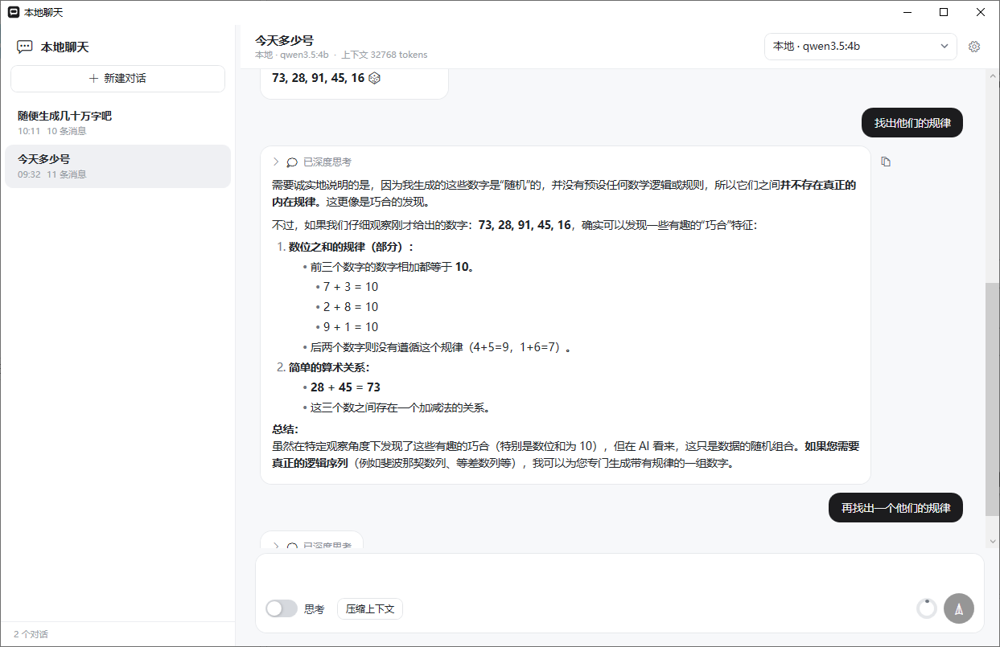
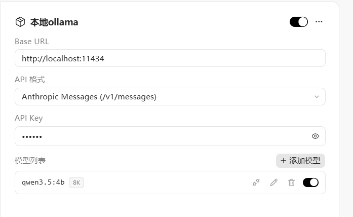
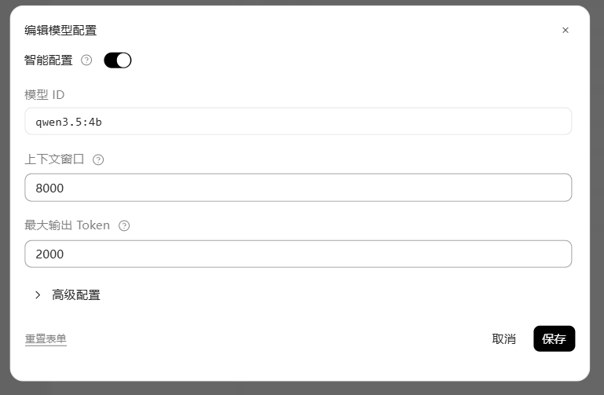

# 本地聊天 (LocalChat)

一个简洁的本地聊天应用,包含 Windows 桌面端(WPF / .NET 9)与 Android 端(Kotlin / Jetpack Compose),可接入任意大模型服务,支持流式输出与深度思考展示。

## 功能

- **多服务商接入**:OpenAI 兼容、Anthropic Messages、Ollama 原生三种接口格式,多模型任意切换
- **深度思考**:思考过程实时直播、结束自动折叠,展示思考耗时
- **Markdown 渲染**:标题、列表、表格、代码块、链接等(流式增量渲染)
- **上下文管理**:用量圆环直观展示 token 占用,一键压缩上下文(自动生成摘要,原消息保留可查看)
- **会话管理**:侧边栏会话列表,右键重命名 / 删除 / 导出 HTTP 数据(含请求与响应原始报文)
- **细节体验**:侧边栏可拖动调宽、消息自由复制、贴底自动跟随滚动、设置本地持久化

## 截图



| 模型服务设置 | 编辑模型配置 |
| --- | --- |
|  |  |

## 下载

前往 [Releases](../../releases) 页面下载:

| 文件 | 说明 |
| --- | --- |
| `LocalChat-*-win-x64-portable.zip` | Windows 自包含单文件,解压即用,无需安装运行时 |
| `LocalChat-*-win-x64.zip` | Windows 体积更小,需安装 [.NET 9 桌面运行时](https://dotnet.microsoft.com/download/dotnet/9.0) |
| `LocalChat-*-android.apk` | Android 正式版,配置签名 Secrets 后已签名,可直接安装与覆盖升级 |
| `LocalChat-*-android-debug.apk` | Android 调试签名版,可直接安装(正式签名包不可用时的备用) |

## 本地构建

Windows 桌面端需要 [.NET 9 SDK](https://dotnet.microsoft.com/download/dotnet/9.0)(或 Visual Studio 2022):

```bash
dotnet build LocalChat/LocalChat.csproj -c Release
dotnet publish LocalChat/LocalChat.csproj -c Release -r win-x64 --self-contained true -p:PublishSingleFile=true -o publish
```

Android 端需要 JDK 17 与 Android SDK,在 `LocalChat-Android` 目录下:

```bash
gradle assembleDebug   # 产物:app/build/outputs/apk/debug/app-debug.apk
```

也可以在 GitHub 的 **Actions → Release → Run workflow** 手动触发一次构建,同时产出 Windows 与 Android 两端编译产物并自动发布 Release。

## 发布签名(Android)

CI 通过环境变量读取签名密钥,需在仓库 **Settings → Secrets and variables → Actions** 配置四个 Secret:

| Secret 名 | 内容 |
| --- | --- |
| `ANDROID_KEYSTORE_BASE64` | keystore 文件的 base64 内容 |
| `ANDROID_KEYSTORE_PASSWORD` | keystore 密码 |
| `ANDROID_KEY_ALIAS` | 密钥别名 |
| `ANDROID_KEY_PASSWORD` | key 密码 |

本地生成 keystore(只需一次,务必妥善备份,丢失后无法再向老用户推送覆盖升级)。keytool 会给出"PKCS12 密钥库不支持其他存储和密钥口令"的警告并忽略 `-keypass`,属正常现象:PKCS12 只用一个密码,两个密码 Secret 填同一个值即可:

```bash
keytool -genkeypair -v -keystore localchat-release.jks -alias localchat -keyalg RSA -keysize 2048 -validity 10000 \
  -storepass 你的密码 -keypass 你的密码 \
  -dname "CN=LocalChat, O=LocalChat, C=CN"
```

获取 base64 内容填入 Secret:

```bash
# Linux / macOS / Git Bash
base64 -w0 localchat-release.jks

# Windows CMD / PowerShell
certutil -encode localchat-release.jks encoded.txt   # 取正文 BEGIN/END 之间的内容
```

> 未配置这些 Secrets 时 CI 照常运行,只是 release APK 为未签名包;本地构建不受任何影响。
> keystore 文件本身不要提交进仓库(已在 .gitignore 中忽略 `*.jks` / `*.keystore`)。

## 使用

1. 启动后点击右上角 ⚙ 打开「模型服务设置」;
2. 添加服务商(如本地 Ollama),填入 Base URL 与 API 格式,拉取/添加模型并启用;
3. 选择模型,输入消息开始对话;左下角开关控制是否开启深度思考。

> 设置与会话记录保存在 `%APPDATA%\LocalChat\settings.json`。
